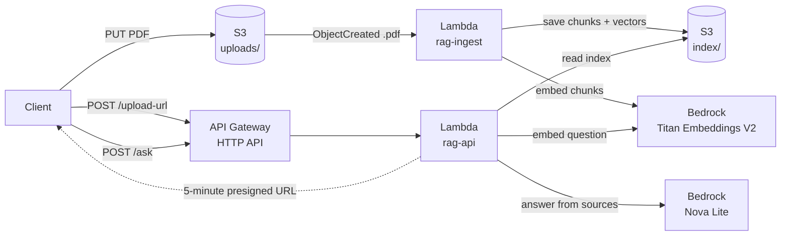

# Serverless RAG Document Assistant

Ask questions about your PDFs and get answers that cite the exact document and page they came from.

Built on AWS Lambda, S3, API Gateway and Amazon Bedrock, with least-privilege IAM, private storage and no servers to manage.

## What it does

1. **Upload a PDF.** The API hands out a short-lived upload link; the file goes straight into a private S3 bucket.
2. **It gets indexed automatically.** S3 triggers a Lambda that extracts the text, splits it into overlapping chunks, and turns each chunk into a vector with Amazon Titan Text Embeddings V2.
3. **Ask a question.** A second Lambda finds the four chunks closest in meaning to the question and sends them to Amazon Nova Lite, which must answer only from those passages and cite them like `[1]`.
4. **Check the answer.** Every response includes the source document, page number, similarity score and a snippet, so a person can verify each claim.

If the documents don't contain the answer, the assistant says so instead of guessing.

## Architecture



| Component | Role |
|---|---|
| `src/rag_core.py` | Shared helpers: chunking, Titan embeddings, cosine-similarity ranking |
| `src/ingest_handler.py` | Lambda `rag-ingest`: PDF → text → chunks → vectors → `index/<file>.json` |
| `src/api_handler.py` | Lambda `rag-api`: `POST /upload-url` and `POST /ask` |
| `policies/` | Least-privilege IAM policies for the two Lambda roles |
| `build.sh` | Packages each Lambda into its own deployment zip |

## How retrieval works

- **Chunking:** each page is split into ~800-character pieces with 150 characters of overlap, cut at word boundaries. Every chunk remembers its page, which is what makes citations possible.
- **Embeddings:** Titan V2 turns each chunk into a 512-number, normalized vector. Texts with similar meaning get vectors pointing in similar directions, so "How do I get my money back?" matches a passage about refunds even with no shared keywords.
- **Ranking:** because the vectors are normalized, a dot product equals cosine similarity. The question's vector is compared against every stored chunk and the top 4 are kept.
- **Generation:** the chunks are sent as numbered sources with a system prompt that requires answering only from them, citing every claim, and saying when the answer isn't there. Temperature is 0.1 for consistent, factual output.

## Security design

| Control | How it's applied |
|---|---|
| **Least privilege** | Two functions, two roles. Ingest can only read `uploads/`, write `index/` and call Titan. The API can only list and read `index/`, sign uploads into `uploads/`, and call Titan and Nova Lite. Neither can delete anything. |
| **Private storage** | S3 Block Public Access is on; objects are encrypted at rest (SSE-S3). |
| **Encryption in transit** | A bucket policy denies any request not sent over HTTPS (`aws:SecureTransport`). |
| **Scoped uploads** | Users never get AWS credentials. Each presigned URL allows one PUT, to one random key under `uploads/`, as `application/pdf`, for 5 minutes. |
| **Input validation** | File names are reduced to a base name (blocks path traversal like `../index/x.pdf`), must end in `.pdf`, and get a random prefix. Questions must be 1–1,000 characters. |
| **No recursive triggers** | The ingest trigger only fires on `uploads/*.pdf`; the function writes `index/*.json`, so its own output can never re-trigger it. |
| **Cost protection** | API Gateway throttling (5 requests/second, burst 10) and capped answer length (600 tokens). |
| **Prompt injection** | The system prompt marks retrieved text as untrusted data, and the model has no tools or actions to misuse. The worst case is a bad answer, which the citations expose. |
| **No stored secrets** | Lambdas use temporary role credentials; no keys exist in the code or the repo. |

## API

### `POST /upload-url`

```json
{ "filename": "handbook.pdf" }
```

Returns `uploadUrl` (presigned PUT URL, valid 5 minutes) and `key` (where the file will land). Upload with:

```bash
curl -X PUT -H "Content-Type: application/pdf" --upload-file handbook.pdf "<uploadUrl>"
```

The `Content-Type` is part of the signature; any other type is rejected with 403.

### `POST /ask`

```json
{ "question": "What does the document say about refunds?" }
```

Returns:

| Field | Meaning |
|---|---|
| `answer` | The model's answer, with `[n]` citations |
| `sources[].n` | Citation number used in the answer |
| `sources[].doc` | Source file |
| `sources[].page` | Page number in that file |
| `sources[].score` | Cosine similarity to the question |
| `sources[].snippet` | First 200 characters of the passage |

## Deploy it yourself

Deployed and tested in **us-east-2 (Ohio)**. Any region offering Titan Text Embeddings V2 and a Bedrock chat model works; update the region in the policy ARNs.

1. **Prerequisites:** AWS CLI v2 configured, Python 3.12, and Bedrock access to `amazon.titan-embed-text-v2:0` and `amazon.nova-lite-v1:0`.
2. **Bucket:** create a private S3 bucket with Block Public Access on and default encryption, then attach this policy:
   ```json
   {
     "Version": "2012-10-17",
     "Statement": [{
       "Sid": "DenyInsecureTransport",
       "Effect": "Deny",
       "Principal": "*",
       "Action": "s3:*",
       "Resource": ["arn:aws:s3:::<bucket>", "arn:aws:s3:::<bucket>/*"],
       "Condition": {"Bool": {"aws:SecureTransport": "false"}}
     }]
   }
   ```
3. **Package:** `./build.sh` produces `build/ingest.zip` (code + pypdf) and `build/api.zip` (code only; boto3 ships with Lambda).
4. **Roles:** create `rag-ingest-role` and `rag-api-role` for Lambda, attach `AWSLambdaBasicExecutionRole`, and add the inline policies from `policies/` (replace the bucket name if yours differs).
5. **Ingest function:** `rag-ingest`, Python 3.12, handler `ingest_handler.handler`, 1024 MB, 15-minute timeout, S3 trigger on object create with prefix `uploads/` and suffix `.pdf`.
6. **API function:** `rag-api`, Python 3.12, handler `api_handler.handler`, 512 MB, 30-second timeout, environment variables `BUCKET` and `CHAT_MODEL_ID`.
7. **API Gateway:** HTTP API with a Lambda integration to `rag-api`, routes `POST /ask` and `POST /upload-url`, `$default` stage with auto-deploy, and default route throttling of 5 rps / burst 10.

## Design decisions

**RAG instead of fine-tuning.** RAG keeps every answer tied to documents a person can check, and adding knowledge means uploading a file, not retraining. Fine-tuning changes how a model writes; it's a poor way to add facts and provides no citations.

**S3 + in-memory search instead of a vector database.** At demo scale (thousands of vectors), a Python dot product is fast and costs nothing. A managed vector store such as OpenSearch Serverless, Postgres with pgvector, or Bedrock Knowledge Bases becomes worthwhile at much larger scale, but adds a fixed monthly cost.

**Chunk size of ~800 characters with 150 overlap.** Small chunks match a single idea precisely; large chunks keep context but dilute the match. The overlap keeps sentences that cross a boundary findable. The right size should be tuned on a test set of real questions.

**Serverless.** Nothing runs or bills while idle. Lambda scales per request, and the always-free Lambda tier covers this workload.

## Limitations and production path

**Current limits**
- Scanned (image-only) PDFs produce no text; they would need OCR such as Amazon Textract.
- The API loads every index file into memory, which suits thousands of chunks, not millions.
- API Gateway HTTP APIs time out at ~30 seconds; long answers would need streaming or async processing.
- Very large PDFs are embedded one chunk at a time inside a single Lambda run (15-minute maximum); a queue would split this into parallel jobs.
- There is no authentication; anyone with the URL can call the API (throttled).

**For a production government deployment**
- Sign-in through Amazon Cognito or the agency's identity provider, with per-user document access
- AWS GovCloud and FedRAMP-authorized services
- Customer-managed KMS keys, versioning and Object Lock where records retention applies
- VPC endpoints so traffic never crosses the public internet
- CloudTrail and CloudWatch alarms for an audit trail
- Bedrock Guardrails for input and output filtering
- Infrastructure as code (CloudFormation, CDK or Terraform) and a CI/CD pipeline with security scanning
- An evaluation set: measure whether the right page is retrieved and whether each citation supports its claim, rerun on every change
- The agency's Authority to Operate (ATO) process

## Lessons learned

- **Read the AccessDenied message closely.** An ingest failure named the exact principal, action and resource. The bucket name in the role policy didn't match the real bucket. Rewriting the policies from a script with a single `BUCKET` variable removed that class of error.
- **IAM permissions aren't the only layer.** An AWS Organizations service control policy restricted which regions could be used, overriding even administrator permissions. The project moved to us-east-2, and the policies were updated to match.
- **Model access isn't the same as model quota.** One account had Bedrock access but a daily token quota of zero for every chat model. Service Quotas showed the cause before any code was written.
- **Guard against recursive triggers.** A function that writes to the bucket that triggers it can loop forever; prefix and suffix filters keep input and output apart.

## Cost

Roughly a few cents to build and test: Titan embeddings cost about $0.02 per million tokens, Nova Lite about $0.06 per million input tokens, Lambda usage falls within the always-free tier, and S3 storage for a few documents is well under a cent per month.
